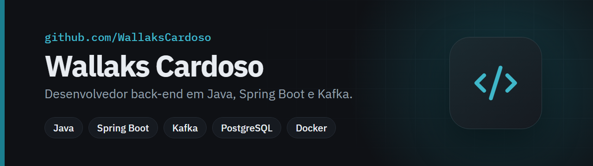
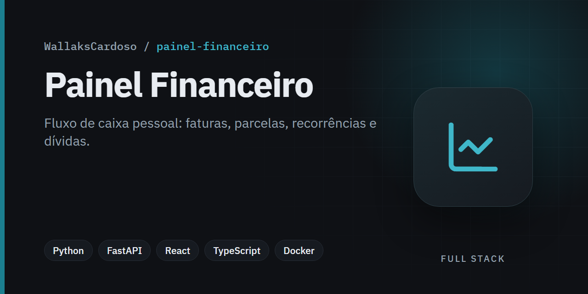
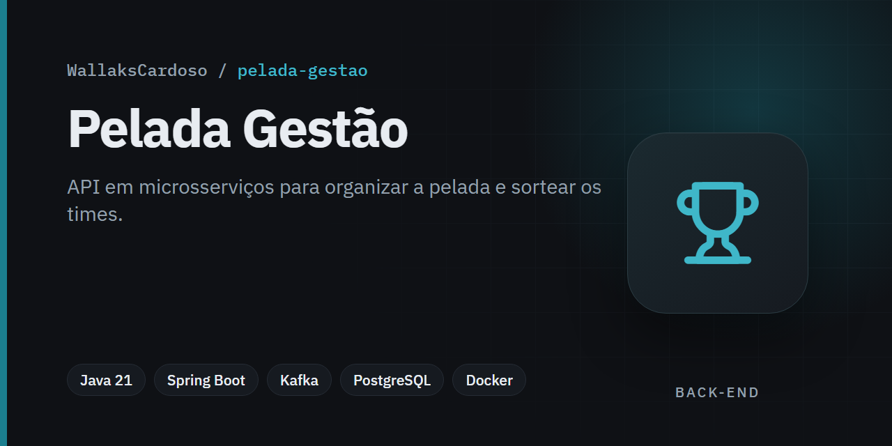
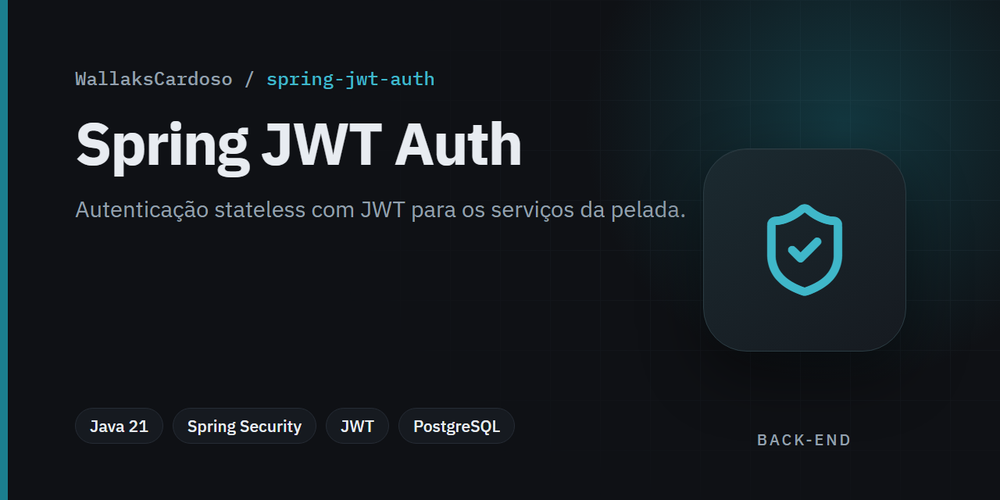
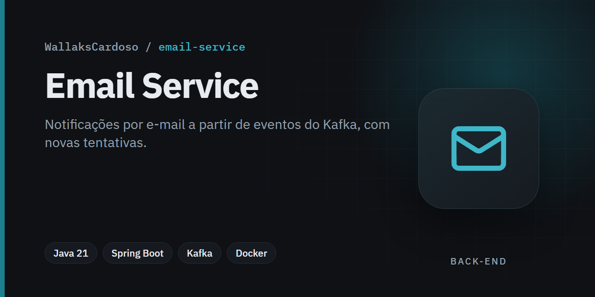
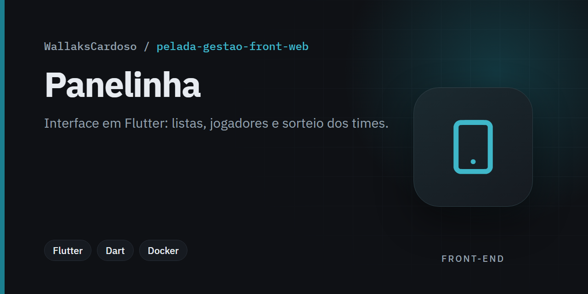
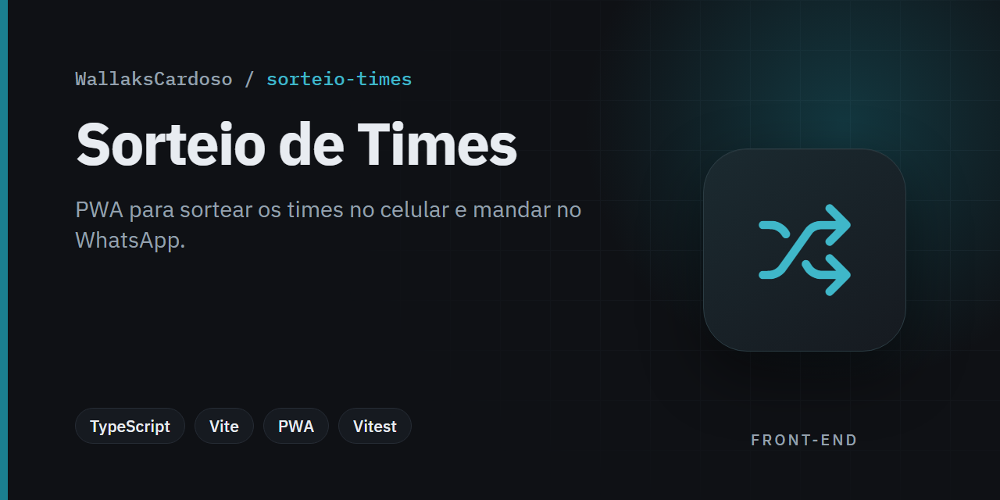
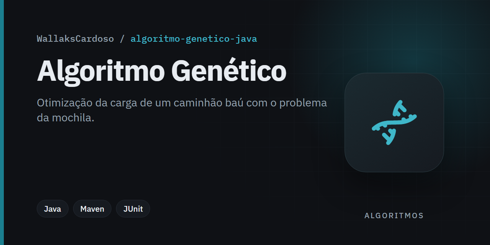
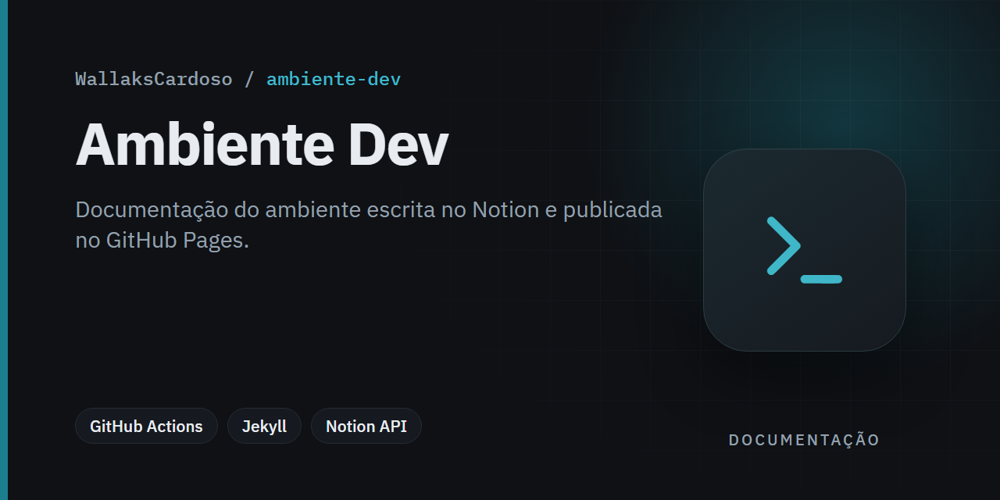

## Sobre mim

Sou um desenvolvedor back-end com formação em Análise e Desenvolvimento de Sistemas. Tenho experiência em projetos utilizando Java (8, 11, 17 e 21), Spring Boot, bancos de dados Oracle (PL/SQL) e MySQL. Já atuei com integrações entre sistemas, automação de processos e APIs REST com foco em performance, segurança e boas práticas.

Atualmente, trabalho na Matera, participando ativamente de uma squad responsável por soluções robustas em ambientes de missão crítica. Busco constantemente evoluir tecnicamente e explorar novas tecnologias como Docker, Kafka e microsserviços.

---

## Habilidades técnicas

**Back-end e Banco de Dados**  

**Ferramentas e DevOps**  

**Qualidade e Testes**  

**Outras ferramentas**  

---

## Projetos em destaque

<table>
  <tr>
    <td width="50%" valign="top">
      
       Fluxo de caixa pessoal com faturas de cartão, parcelas, recorrências e dívidas.
    </td>
    <td width="50%" valign="top">
      
       API em microsserviços para organizar a pelada; sobe completa com Docker Compose.
    </td>
  </tr>
  <tr>
    <td width="50%" valign="top">
      
       Autenticação stateless com JWT usada pelos serviços da pelada.
    </td>
    <td width="50%" valign="top">
      
       Notificações por e-mail a partir de eventos do Kafka, com novas tentativas e tópico de erro.
    </td>
  </tr>
  <tr>
    <td width="50%" valign="top">
      
       Interface em Flutter do sistema da pelada, para web e celular.
    </td>
    <td width="50%" valign="top">
      
       PWA para sortear os times no celular e compartilhar no WhatsApp.
    </td>
  </tr>
  <tr>
    <td width="50%" valign="top">
      
       Algoritmo genético para otimizar a carga de um caminhão baú.
    </td>
    <td width="50%" valign="top">
      
       Documentação do ambiente de desenvolvimento, do Notion para o GitHub Pages.
    </td>
  </tr>
</table>

---

## Experiências recentes

**Desenvolvedor Back-End | Matera (jul/2024 - atual)**  
Atuação em uma squad responsável por soluções críticas com foco em Java, Spring, PL/SQL, Kafka e Docker.

**Desenvolvedor Back-End | Conexos (mar/2023 – jul/2024)**  
Trabalho com integração de sistemas no setor de Comércio Exterior. Responsável por criação e manutenção de APIs, automações, documentação com Swagger e melhorias de desempenho em PL/SQL.

**Analista de Relatórios | Conexos (abr/2022 – mai/2023)**  
Responsável por viabilidade técnica de demandas, ajustes em relatórios com Jasper Reports e otimizações em banco de dados Oracle.

**Estagiário Back-End (dez/2021 – mar/2022)**  
Primeiro contato com PL/SQL e desenvolvimento orientado a objetos com Java 11. Apoio em integrações com ERP.

---

## Contato

- LinkedIn: [linkedin.com/in/wallakscardoso](https://www.linkedin.com/in/wallakscardoso/)
- E-mail: **wallakscardoso@gmail.com**

---
